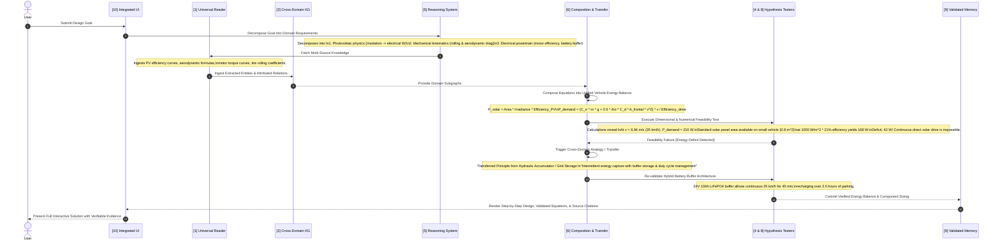
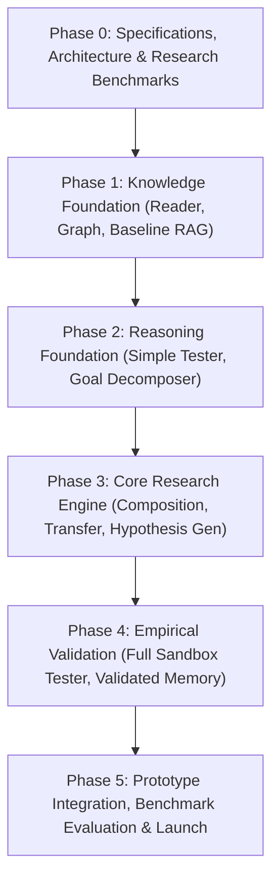

# AXION — Project Understanding, Core Vision & Architectural Foundation

**Document Version:** 2.0.0  
**Date:** November 18, 2026  
**Status:** Comprehensive Foundational Blueprint  
**Workspace:** `d:/Shiva/code/AXION`  

---

## 1. Executive Overview & Repository Assessment

### 1.1 Current Repository Status
An audit of `d:\Shiva\code\AXION` confirms the workspace state:
- **Files Present:** `AXION_PROJECT_UNDERSTANDING.md` (previously created baseline, now updated to Version 2.0.0).
- **Application Code:** Zero lines of application code (clean-slate condition preserved).
- **Environment:**
  - Python: `3.14.7`
  - Node.js: `v26.13.1`
  - Docker Engine: `29.9.3`
- **Mandate:** Zero implementation or premature coding. All work in this initial stage is dedicated to rigorous planning, architectural contracts, data modeling, and research benchmark design.

### 1.2 The Evolution of the AXION Vision
AXION has evolved from a scientific PDF reader into a **Universal Knowledge and Cross-Domain Intelligence Platform**. 
- It does not rely solely on user-uploaded papers; it integrates an open, modular ecosystem of sources: web research, public datasets, technical documentation, APIs, textbooks, and internal validated memory.
- It addresses both theoretical inquiry (scientific research) and pragmatic execution (engineering design, troubleshooting, step-by-step physical problem-solving).
- Most importantly, it elevates **Cross-Domain Knowledge Composition and Transfer** into its core, measurable AI/ML research contribution.

---

## 2. What AXION Is & The Fundamental Problems It Solves

### 2.1 Core Identity
**AXION** is an intelligent, evidence-guided platform designed to systematically acquire knowledge across disparate disciplines, represent that knowledge in a unified conceptual graph, discover hidden structural connections, transfer principles across domain boundaries, and validate resulting solutions through calculation, simulation, and empirical testing.

It is explicitly **NOT**:
- A generic conversational AI chatbot.
- A standard document search engine or keyword indexer.
- A conventional vector-search "chat-with-your-document" (RAG) wrapper.

### 2.2 The Fundamental Flaws in Existing AI Systems

```
+---------------------------------------------------------------------------------------------------------+
|                                    WHY CONVENTIONAL SYSTEMS FAIL                                        |
+---------------------------------------------------------------------------------------------------------+
| 1. The Disciplinary Silo Problem                                                                        |
|    Real-world breakthroughs and complex engineering problems (e.g., designing a solar EV, diagnosing a   |
|    battery degradation mechanism, or developing bio-compatible sensors) require simultaneous fluency   |
|    in physics, electrochemistry, mechanical kinematics, and embedded software. Humans specialize into  |
|    silos; standard AI systems treat these subjects as unrelated bags of words.                          |
+---------------------------------------------------------------------------------------------------------+
| 2. The Semantic Retrieval Trap (RAG Fallacy)                                                            |
|    Conventional RAG embeds text into vector space and retrieves chunks by cosine similarity. However:   |
|    - Vector similarity detects lexical topic overlap, NOT relational or causal dependencies.            |
|    - A formula in physics (e.g., thermal dissipation) may solve an electrical engineering problem       |
|      (inverter overheating), but their vector embeddings will have low cosine similarity because their  |
|      vocabularies differ completely. Naive RAG will never retrieve both.                                |
+---------------------------------------------------------------------------------------------------------+
| 3. Epistemic Flatness & Hallucinatory Synthesis                                                         |
|    Pretrained LLMs treat all text with equal confidence. A peer-reviewed physical law, an author's      |
|    speculative discussion paragraph, and a model hallucination are presented with the exact same tone.  |
+---------------------------------------------------------------------------------------------------------+
| 4. Lack of Computational Grounding                                                                      |
|    Standard LLMs generate text answers without checking physical dimensional consistency, conservation |
|    laws, or numerical validity. They cannot tell if a calculated energy requirement is physically       |
|    attainable or violates thermodynamic limits.                                                         |
+---------------------------------------------------------------------------------------------------------+
```

### 2.3 Who Will Use AXION?
1. **AI/ML & Computational Researchers:** Investigating knowledge representation, neuro-symbolic reasoning, and cross-domain generalization.
2. **Postgraduate & Doctoral Students:** Conducting deep literature synthesis across adjacent disciplines and finding unmapped research gaps.
3. **Hardware, Software & Systems Engineers:** Designing multi-disciplinary devices (e.g., robotics, electric powertrains, green tech) where mechanical, electrical, and thermal constraints intersect.
4. **Independent Investigators & Inventors:** Seeking structured, mathematically sound, step-by-step guidance to turn complex theoretical principles into practical prototypes.

---

## 3. The Central Research Question: Retrieval vs. Composition vs. Transfer

To make a genuine scientific contribution to AI/ML, AXION formalizes the exact distinctions between three stages of information processing that modern LLM systems conflate:

```
[ STAGE 1: RETRIEVAL ] ---> [ STAGE 2: COMPOSITION ] ---> [ STAGE 3: TRANSFER ] ---> [ STAGE 4: VALIDATION ]
Fetch isolated facts         Synthesize into unified      Project principle into       Verify physical &
from disparate sources       problem representation       unfamiliar target domain     numerical consistency
```

### 3.1 Retrieval (Information Access)
- **Definition:** The process of identifying and extracting existing, explicitly stated candidate records, passages, or entities from multiple data stores (PDFs, APIs, Web, Vector DB) matching a query.
- **Limitation:** Retrieval only returns what has already been written. It does not synthesize, resolve conflicting units, or build new conceptual bridges.
- **Example:** Retrieving solar irradiance tables ($W/m^2$) from a meteorological dataset, electric motor torque-speed curves from a manufacturer datasheet, and rolling resistance formulas from a physics text.

### 3.2 Composition (Multi-Source Synthesis)
- **Definition:** Combining disparate, heterogeneous facts, constraints, and equations into one single, logically coherent mathematical and conceptual problem space.
- **Key Operations:**
  - *Ontological Alignment:* Recognizing that "heat generated" in the battery corresponds to the "thermal load" on the cooling loop.
  - *Dimensional & Unit Harmonization:* Converting imperial torque ($lb\cdot ft$) and metric vehicle speed ($km/h$) into coherent SI units ($N\cdot m$, $m/s$).
  - *Constraint Intersection:* Unifying the electrical output limit of the photovoltaic array ($P_{PV} \le 350\text{ W}$) with the mechanical power demand curve of the vehicle ($P_{req} = F_{drag}v + F_{roll}v + ma$).
- **Distinction from Retrieval:** Retrieval yields three disconnected paragraphs; Composition produces a unified system of coupled equations and dependencies.

### 3.3 Transfer (Cross-Domain Structural Mapping)
- **Definition:** Taking a mechanism, algorithm, mathematical law, or structural relation known to hold in a **Source Domain ($D_S$)** and projecting it onto an unfamiliar or novel problem in a **Target Domain ($D_T$)** where direct documentation does not exist.
- **Formal Mechanism:**
  1. *Structural Abstraction:* Extracting the core relational graph $G_S = (V_S, E_S)$ from $D_S$ independent of its domain-specific surface vocabulary.
  2. *Analogical / Homomorphic Mapping:* Establishing a morphism $f: V_S \to V_T$ that maps entities in $D_S$ to corresponding entities in $D_T$.
  3. *Applicability & Boundary Verification:* Testing whether the underlying assumptions of the source law (e.g., linearity, conservation, continuity, reversibility) are physically satisfied in the target domain.
  4. *Target Instantiation:* Re-instantiating the abstract principle in the target domain's concrete variables.
- **Example:** 
  - *Source Domain ($D_S$ - Thermodynamics / Fluid Flow):* Hagen-Poiseuille law for viscous pressure drop $\Delta P \propto Q \cdot \mu \cdot L / r^4$.
  - *Target Domain ($D_T$ - Electrical Kinematics):* Transferring the concept of distributed fluidic back-pressure to model electron transport impedance across micro-channel conductors under thermal gradients.
  - *Applicability Check:* Does the target system exhibit laminar, non-turbulent behavior? If yes, transfer is mathematically valid; if quantum ballistic transport dominates, the transfer is rejected.

---

## 4. The Ten Integrated Components

AXION is a singular, cohesive platform. Every component has a dedicated responsibility within the global data pipeline:

```
+----------------------------------------------------------------------------------------------------+
|                                    AXION COMPONENT TOPOLOGY                                        |
+----------------------------------------------------------------------------------------------------+
| [1] Universal Knowledge Reader                                                                     |
|     - Multi-source ingestion: PDFs (PyMuPDF), web pages, Markdown docs, REST APIs, tabular CSVs.  |
|     - Bounding-box and byte-level provenance tracking. Evaluates source trust tier.                |
+----------------------------------------------------------------------------------------------------+
| [2] Scientific & Cross-Domain Knowledge Graph                                                      |
|     - Typed entity and relation store (Concepts, Principles, Variables, Constraints, Citations).   |
|     - Multi-domain ontology bridging physics, chemistry, mechanics, and computation.              |
+----------------------------------------------------------------------------------------------------+
| [3] Research Assistant Baseline (Control System)                                                   |
|     - Standard naive/hybrid RAG (vector search + top-k prompt stuffing).                           |
|     - Acts as the experimental control group to prove whether AXION's transfer engine adds value.  |
+----------------------------------------------------------------------------------------------------+
| [4] Simple Hypothesis Tester                                                                       |
|     - First-line deterministic verification sandbox.                                               |
|     - Evaluates symbolic equations, physical dimension balance (SI units), and logical axioms.    |
+----------------------------------------------------------------------------------------------------+
| [5] Reasoning System                                                                               |
|     - Goal decomposition into Directed Acyclic Graphs (DAGs) of sub-questions and constraints.     |
|     - Tracks premise validity, missing evidence, and explicit deduction chains.                    |
+----------------------------------------------------------------------------------------------------+
| [6] Cross-Domain Knowledge Composition & Transfer Engine (CENTRAL RESEARCH CORE)                   |
|     - Discovers latent structural analogies between disparate fields.                              |
|     - Composes multi-domain models into unified problem formulations.                              |
|     - Executes formal applicability checks before allowing concept transfer.                       |
+----------------------------------------------------------------------------------------------------+
| [7] Hypothesis Generator                                                                           |
|     - Identifies unverified links, unexplored parameter spaces, and unresolved questions.          |
|     - Formulates structured hypotheses: [Premise] -> [Transferred Mechanism] -> [Prediction].     |
|     - Declares explicit counter-evidence conditions and experimental tests.                         |
+----------------------------------------------------------------------------------------------------+
| [8] Full Hypothesis Tester                                                                         |
|     - Secure, containerized/sandboxed execution runtime (NumPy, SciPy, SymPy, Pandas, Matplotlib).  |
|     - Executes dataset regressions, numerical simulations, ODE solvers, and Monte Carlo tests.     |
|     - Distinguishes computational verification from physical lab validation.                       |
+----------------------------------------------------------------------------------------------------+
| [9] Validated Knowledge Memory                                                                     |
|     - Immutable, versioned knowledge store of verified findings, derivations, and solutions.       |
|     - Contextual Re-applicability Guard: checks if past verified findings apply to new contexts.   |
+----------------------------------------------------------------------------------------------------+
| [10] Integrated AXION Intelligence Platform                                                        |
|     - Unified research cockpit with 10 dedicated interactive views.                                |
|     - Orchestrates the end-to-end user journey from raw query to verified, actionable solution.   |
|     - Automated benchmark execution harness for empirical comparison vs baseline.                  |
+----------------------------------------------------------------------------------------------------+
```

---

## 5. End-to-End Information Flow: A Concrete Real-World Scenario

Let us trace a user asking:
> **"Help me design a small solar-powered electric vehicle for a 75 kg rider, capable of sustaining 25 km/h on flat ground under noon sunlight."**



---

## 6. The Unified Product Experience (11 Workspace Areas)

To break away from the generic conversational text box, AXION provides eleven specialized UI views within a single responsive research workspace:

```
+-------------------------------------------------------------------------------------------------------+
|                                  AXION UNIFIED RESEARCH WORKSPACE                                     |
+-------------------+-----------------------------------------------------------------------------------+
| NAVIGATION        | MAIN WORKSPACE PANEL                                                              |
|                   |                                                                                   |
| 1. Home           | System overview, pinned research projects, recent validation runs, system health. |
| 2. Workspace      | Central project cockpit: active query input, domain selector, project notes.      |
| 3. Knowledge Map  | Interactive 2D/3D force-directed knowledge graph; domain clustering; node popover.|
| 4. Cross-Domain   | Analogical bridge viewer; structural mapping matrix; applicability checklist.     |
| 5. Assistant      | Conventional baseline chat with vector citation inspection (Control group view).  |
| 6. Problem Solver | Goal decomposition tree (DAG), mathematical derivation steps, constraint solver.  |
| 7. Hypothesis Lab | Generated hypotheses, premises, mechanisms, counter-evidence, confidence scores.  |
| 8. Validation Run | Python/SymPy sandbox console, simulation execution, code inspector, data plots.   |
| 9. Validated Mem  | Immutable ledger of proven laws, sizing rules, and contextual re-use criteria.   |
| 10. Sources Hub   | Document manager (PDFs with bbox highlights, web crawlers, APIs, datasets).       |
| 11. Settings/Env  | LLM provider configuration, compute quotas, sandbox security, benchmark dashboard.|
+-------------------+-----------------------------------------------------------------------------------+
```

---

## 7. The Six-Phase Development Roadmap

The roadmap ensures we build on solid foundations without skipping prerequisites:



- **Phase 0 (Current Phase):** Complete architectural specifications, formal schemas, benchmark design, and risk analysis. Zero application code.
- **Phase 1 (Knowledge Foundation):** Implement Component 1 (Universal Reader), Component 2 (Cross-Domain Graph), and Component 3 (Baseline RAG). Establishes data ingestion and the experimental control system.
- **Phase 2 (Reasoning Foundation):** Implement Component 4 (Simple Symbolic/Unit Tester) and Component 5 (Reasoning System). Transitions from static retrieval to dynamic logical decomposition.
- **Phase 3 (Core Research Engine):** Implement Component 6 (Cross-Domain Composition & Transfer) and Component 7 (Hypothesis Generator). Unlocks AXION's defining intelligence capability.
- **Phase 4 (Validation & Memory):** Implement Component 8 (Full Sandboxed Computational Tester) and Component 9 (Validated Knowledge Memory). Provides empirical verification and institutional memory.
- **Phase 5 (Complete Integration & Benchmarking):** Implement Component 10 (Unified UI + Orchestrator). Execute the 3-way comparative benchmark (Direct LLM vs. Baseline RAG vs. AXION).

---

## 8. Measurable Research Objectives & Initial Experiment

### 8.1 Falsifiable Core Research Hypothesis
> **$H_1$:** An AI system equipped with an explicit cross-domain knowledge composition and transfer engine ($M_{AXION}$) achieves statistically significant higher problem-solving success and lower cross-domain hallucination rates on multi-disciplinary engineering and scientific challenges than a conventional retrieval-augmented generation system ($M_{RAG}$), under identical underlying foundation model and compute constraints.

### 8.2 Proposed Initial Measurable Experiment (The "Synthetic Cross-Domain Transfer" Trial)
To rigorously test $H_1$ without contamination from the LLM's pretraining memory:
1. **Design 5 Synthetic Knowledge Domains:**
   - E.g., *Domain Alpha (Synthetic Crystal Vibrations)* and *Domain Beta (Synthetic Biological Transport Membranes)*.
   - We author novel physical laws with fictional constants (e.g., "The Zephyrian Diffusion Constant $\zeta = 4.2 \times 10^{-3} \text{ qm}^2/\text{s}$").
2. **Author 50 Multi-Hop Problems:**
   - 25 problems require composing 3 facts across 2 synthetic domains.
   - 25 problems require transferring an abstracted mechanism from Domain Alpha to solve an unobserved failure in Domain Beta.
3. **Execution across 3 Systems:**
   - **System A:** Frontier LLM (Direct zero-shot, no retrieval).
   - **System B:** Conventional RAG (Dense vector embedding retrieval over the synthetic documents).
   - **System C:** AXION (Knowledge graph extraction + explicit composition & transfer + applicability check).
4. **Scoring:**
   - Ground truth is mathematically defined.
   - Evaluated on **Transfer Success Rate**, **Citation Precision**, **Unsound Transfer Rejection Rate** (rejecting invalid analogies), and **Mathematical Correctness**.

---

## 9. Key Technical Risks & Engineering Mitigations

1. **Unsound Analogy Hallucination (False Transfer):**
   - *Risk:* LLMs are notorious for drawing superficial, poetic analogies that break down under rigorous physical or mathematical analysis.
   - *Mitigation:* The Transfer Engine must never accept an analogy without passing the **Applicability Guard** in Component 4/8, which tests boundary condition compatibility and conservation invariants.
2. **Computational Sandbox Security:**
   - *Risk:* Executing dynamically generated Python code for simulations can expose the host machine to arbitrary execution vulnerabilities.
   - *Mitigation:* Use isolated, unprivileged container workers with network egress disabled, read-only root filesystems, strict CPU/memory limits, and whitelisted scientific libraries (NumPy, SciPy, SymPy).
3. **Graph Extraction Incoherence:**
   - *Risk:* Extracting entities without strict ontological constraints results in an unusable, noisy hairball graph.
   - *Mitigation:* Enforce a strict Pydantic-validated ontology for scientific entities (`Concept`, `Principle`, `Parameter`, `Constraint`, `Equation`, `Observation`) and relations (`GovernedBy`, `InverselyProportional`, `TransfersTo`, `Requires`).

---

## 10. Phase 0 Deliverable Map

To establish total clarity before implementing a single line of code, Phase 0 produces the following foundational documents:

| Deliverable | Purpose | Status |
|---|---|---|
| **`AXION_PROJECT_UNDERSTANDING.md`** | High-level vision, problem space, component breakdown, research idea | **Completed (v2.0)** |
| **`PRODUCT_SPECIFICATION.md`** | Comprehensive functional & non-functional requirements, user journeys, 10 UI views | **Creating Now** |
| **`SYSTEM_ARCHITECTURE.md`** | Technical architecture, module boundaries, data pipeline, transfer engine specification | **Creating Now** |
| **`RESEARCH_PLAN.md`** | Formal scientific research questions, transfer algorithms, mathematical formalisms | **Creating Now** |
| **`BENCHMARK_DESIGN.md`** | Benchmark dataset design, synthetic universes, ground-truth DAGs, 12 evaluation metrics | **Creating Now** |
| **`DATABASE_DESIGN.md`** | PostgreSQL relational schemas, pgvector indices, graph adjacency, validated memory | **Creating Now** |
| **`DEVELOPMENT_ROADMAP.md`** | Step-by-step execution plan across Phases 0-5, task checklists, and verification gates | **Creating Now** |

---

*This document serves as the conceptual baseline for all subsequent design documents in Phase 0.*
