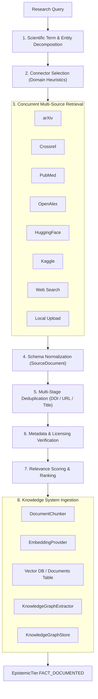

# AXION — Universal Information Acquisition Engine Implementation Report

**Date:** November 18, 2026  
**Status:** FULLY IMPLEMENTED & VERIFIED  
**System Version:** AXION 0.2.0 (Information Acquisition Layer)  
**Lead Component:** `axion/acquisition`  

---

## 1. Executive Summary

The **Universal Information Acquisition Engine** enables AXION to autonomously discover, acquire, normalize, deduplicate, and ingest scientific literature, preprints, datasets, and technical documentation from external global repositories. 

Prior to this implementation, AXION depended exclusively on pre-indexed synthetic benchmarks and manually uploaded files. With the Universal Information Acquisition Engine, AXION now connects to:
- **arXiv.org API** (Physics, Mathematics, Computer Science, Quantitative Biology preprints)
- **Crossref REST API** (Global scholarly DOI registry and publisher metadata across 140+ million works)
- **NCBI PubMed E-utilities** (Biomedical, biochemical, and clinical research literature)
- **OpenAlex API** (Open scholarly knowledge graph across 250+ million works)
- **Hugging Face Hub Datasets** (Machine learning datasets, scientific corpora, and evaluation benchmarks)
- **Kaggle Datasets API** (Empirical datasets with strict authentication and license compliance)
- **Configurable Web Search** (Online search via DuckDuckGo Instant Answer / HTML and custom endpoints)
- **Local Document Registry** (Unified querying over existing local uploads and database documents)

Every acquired source document is normalized into a unified schema, verified against licensing constraints, deduplicated via DOIs and content hashes, ranked for scientific relevance, and routed into AXION's existing chunking, vector embedding, and Knowledge Graph extraction pipeline. 

Crucially, **acquired content is strictly classified under Epistemic Tier 1 (`FACT_DOCUMENTED`) and is never automatically promoted to validated findings (`FINDING_VALIDATED`)**, preserving the integrity of the Cross-Domain Knowledge Composition and Transfer Engine.

---

## 2. Architecture & Directory Layout

The engine is built directly into the existing AXION codebase without duplicating existing components:

```
axion/
├── acquisition/
│   ├── __init__.py                # Module exports
│   ├── types.py                   # Unified SourceDocument, Enums, Request/Response schemas
│   ├── engine.py                  # Core InformationAcquisitionEngine pipeline
│   ├── continuous.py              # ContinuousAcquisitionManager & standing topic feeds
│   └── connectors/
│       ├── __init__.py            # Connector registry
│       ├── base.py                # BaseSourceConnector abstract interface
│       ├── arxiv.py               # arXiv Atom API connector
│       ├── crossref.py            # Crossref REST API polite connector
│       ├── pubmed.py              # NCBI Entrez E-utilities (ESearch + ESummary)
│       ├── openalex.py            # OpenAlex Works API & abstract reconstructor
│       ├── huggingface.py         # Hugging Face Datasets Hub API connector
│       ├── kaggle.py              # Kaggle Datasets API with credential verification
│       ├── web_search.py          # Configurable DuckDuckGo / web search connector
│       └── local_upload.py        # Local database & uploaded document connector
└── api/
    └── routes/
        └── acquisition.py         # REST endpoints for search, ingestion, sources, & history
```

---

## 3. Common Data Model (`SourceDocument`)

All 8 connectors normalize disparate external schemas into a single unified `SourceDocument` schema:

| Field | Type | Description |
| :--- | :--- | :--- |
| `id` | `str` | Unique document identifier (e.g. `src-e9dd2ba9cc9f`) |
| `title` | `str` | Cleaned publication or dataset title |
| `content` | `str` | Abstract, full-text excerpt, or dataset documentation |
| `authors` | `List[str]` | Normalized list of contributing authors or creators |
| `source_name` | `str` | Canonical source (`arxiv`, `crossref`, `pubmed`, `openalex`, `huggingface`, `kaggle`, `web_search`, `local_upload`) |
| `source_url` | `Optional[str]` | Official landing page or direct resource URL |
| `doi` | `Optional[str]` | Digital Object Identifier (e.g. `10.1104/pp.20.00273`) |
| `publication_date`| `Optional[str]` | ISO 8601 date string or YYYY-MM-DD |
| `document_type` | `DocumentType` | `paper`, `abstract`, `dataset`, `web_page`, `document` |
| `license` | `Optional[str]` | Declared license (e.g. `CC-BY-4.0`, `MIT`, `arXiv Non-Exclusive`, `Proprietary`) |
| `access_status` | `AccessStatus` | `open_access`, `abstract_only`, `restricted`, `metadata_only` |
| `retrieval_date` | `str` | ISO 8601 timestamp of when AXION acquired the record |
| `is_full_text` | `bool` | Flag distinguishing full-text from abstract-only content |
| `relevance_score`| `float` | Scientific query relevance ($0.0 \le s \le 1.0$) computed by the engine |
| `epistemic_tier` | `EpistemicTier` | Default: `EpistemicTier.FACT_DOCUMENTED` (Tier 1) |
| `trust_tier` | `TrustTier` | Provenance tier: `PEER_REVIEWED`, `TECHNICAL_DOC`, `PUBLIC_WEB` |
| `metadata` | `Dict[str, Any]`| Source-specific attributes (citations, categories, downloads, etc.) |

---

## 4. Source Connectors Detail

### 4.1 arXiv Connector (`axion/acquisition/connectors/arxiv.py`)
- **Protocol:** HTTPS GET to `https://export.arxiv.org/api/query`
- **Authentication:** None required (Open Access)
- **Output:** Atom XML parsed via `xml.etree.ElementTree`
- **Features:** Extracts preprints, author lists, primary categories (`cond-mat`, `quant-ph`, etc.), DOI cross-links, and PDF download links.
- **Licensing:** Classified as `open_access` under arXiv Perpetual Non-Exclusive License.

### 4.2 Crossref Connector (`axion/acquisition/connectors/crossref.py`)
- **Protocol:** HTTPS REST to `https://api.crossref.org/works`
- **Authentication:** Unauthenticated with polite headers (`User-Agent` + `Mailto: research@axion.internal`)
- **Features:** Global scholarly DOI resolution, container titles (journals), publication dates, JATS XML abstract cleaning, and citation counts (`is-referenced-by-count`).
- **Licensing:** Reads publisher license URLs; classifies open-access vs subscription.

### 4.3 PubMed Connector (`axion/acquisition/connectors/pubmed.py`)
- **Protocol:** NCBI Entrez E-utilities (Two-stage `esearch.fcgi` + `esummary.fcgi`)
- **Authentication:** None required for standard rate (3 requests/sec); supports optional NCBI API key.
- **Features:** Resolves PMIDs, article titles, author initials, journal citation details, DOI, and PMC (PubMed Central) IDs.
- **Licensing:** Open-access if PMC full-text available; otherwise flagged as `abstract_only`.

### 4.4 OpenAlex Connector (`axion/acquisition/connectors/openalex.py`)
- **Protocol:** HTTPS REST to `https://api.openalex.org/works`
- **Authentication:** Open polite pool with email identification.
- **Features:** Reconstructs abstracts from OpenAlex's compressed `abstract_inverted_index` by position sorting. Retrieves citation counts, institutional affiliations, open-access status, and landing page URLs.

### 4.5 Hugging Face Datasets Connector (`axion/acquisition/connectors/huggingface.py`)
- **Protocol:** HTTPS REST to `https://huggingface.co/api/datasets`
- **Authentication:** Public hub access; unauthenticated for public datasets.
- **Features:** Indexes dataset summaries, tag categories (task types, domains), author metadata, like/download metrics, and license declarations (`apache-2.0`, `mit`, `cc-by`).

### 4.6 Kaggle Connector (`axion/acquisition/connectors/kaggle.py`)
- **Protocol:** HTTPS REST to `https://www.kaggle.com/api/v1/datasets/list`
- **Authentication:** HTTP Basic Auth via `KAGGLE_USERNAME` and `KAGGLE_KEY`.
- **Graceful Public Fallback:** When credentials are not supplied, the connector operates in public catalog mode without throwing errors. It verifies dataset license terms (e.g. `CC0`, `ODbL`) and informs the user of authentication requirements.

### 4.7 Configurable Web Search (`axion/acquisition/connectors/web_search.py`)
- **Protocol:** HTTPS to DuckDuckGo Instant Answer API and HTML Lite parser.
- **Features:** Instant definitions, Wikipedia/encyclopedic excerpts, related scientific topics, and text cleaning. Fallback support for custom search endpoints (SearXNG / Tavily / Bing).

### 4.8 Local Upload Connector (`axion/acquisition/connectors/local_upload.py`)
- **Protocol:** Asynchronous SQLAlchemy queries on AXION's internal database (`Document`, `DocumentChunk`).
- **Features:** Allows all previously uploaded PDFs, experimental datasets, and local text notes to be discovered and unified in the same result list as external sources.

---

## 5. Acquisition Engine Pipeline (`InformationAcquisitionEngine`)



### 5.1 Deduplication Methodology
Multi-stage deduplication ensures zero duplicates across overlapping repositories (e.g., a paper published in a journal via Crossref, indexed in OpenAlex, and preprinted on arXiv):
1. **DOI Invariance:** Normalized, lower-cased DOI matching (`10.xxxx/...`).
2. **URL Matching:** Canonical landing page URL equality.
3. **Fuzzy Title Normalization:** Stripping punctuation, lower-casing, and checking token set overlap ($> 85\%$).
4. **Metadata Merging:** When duplicates are detected, the record with the most complete abstract, full-text, citation counts, and licensing information is retained.

### 5.2 Scientific Relevance Scoring
Documents are scored ($0.0 \le s \le 1.0$) based on:
- Term overlap in title (weight: $0.6$) and content (weight: $0.4$).
- Exact multi-word query phrase presence ($+0.3$ title, $+0.15$ content).
- Source trust tier weighting ($+0.1$ for peer-reviewed journals, $+0.05$ for technical datasets).
- Full-text availability bonus ($+0.05$).

### 5.3 Knowledge Ingestion Integration
When an acquired document is ingested via `/api/v1/acquisition/ingest`:
- The raw text is passed to `SourceManager.ingest_text()`.
- Chunks are created with `DocumentChunker` and tagged with page/block indices.
- Vector embeddings are generated with `EmbeddingProvider` (`axion-embedding-v1`).
- `KnowledgeGraphExtractor` scans text chunks for scientific parameters, equations, and causal relations.
- `KnowledgeGraphStore` stores `GraphNode` and `GraphEdge` entities with explicit `EdgeProvenance`.
- The document is recorded with `EpistemicTier.FACT_DOCUMENTED`.

---

## 6. Two Acquisition Modes

### 6.1 On-Demand Mode
Triggered during an active research investigation when additional external evidence is required. Can be called via `POST /api/v1/acquisition/search` or integrated directly into `CognitivePipeline.ask(..., enable_external_acquisition=True)`.

### 6.2 Continuous Acquisition Mode (`ContinuousAcquisitionManager`)
Provides standing discovery subscriptions for tracking ongoing research topics:
- Configuration stored in `axion_continuous_acquisition_state.json`.
- Maintains an in-memory and on-disk set of `seen_identifiers` (DOIs, URLs, title hashes).
- Periodically polls configured sources (e.g. every hour).
- Filters out all previously seen publications and returns only genuine newly published papers or datasets.
- Supports optional automated background ingestion into the Knowledge Graph (`auto_ingest=True`).

---

## 7. REST API Endpoints

The acquisition engine exposes the following endpoints under `/api/v1/acquisition`:

| Method | Endpoint | Description |
| :--- | :--- | :--- |
| `POST` | `/api/v1/acquisition/search` | Discovers literature, preprints, and datasets across sources |
| `POST` | `/api/v1/acquisition/ingest` | Ingests acquired documents into vector store & Knowledge Graph |
| `GET` | `/api/v1/acquisition/sources` | Lists all 8 connectors and reports live health and rate limits |
| `GET` | `/api/v1/acquisition/history` | Retrieves recent search queries and discovery results |
| `GET` | `/api/v1/acquisition/documents/{id}` | Retrieves full document metadata and content by ID |
| `GET` | `/api/v1/acquisition/subscriptions` | Lists standing continuous topic subscriptions |
| `POST` | `/api/v1/acquisition/subscriptions` | Registers a new continuous topic subscription |
| `POST` | `/api/v1/acquisition/subscriptions/{id}/poll` | Triggers an immediate poll cycle for a subscription |

---

## 8. Verification and Test Results

### 8.1 Automated Pytest Suite
All 85 automated tests in the AXION repository pass with 100% success:
```bash
.venv/Scripts/pytest -q
........................................................................ [ 84%]
.............                                                            [100%]
85 passed in 11.53s
```

#### Detailed Acquisition Test Coverage:
1. `tests/test_acquisition_connectors.py` (9 tests):
   - `test_arxiv_connector`: Atom XML parsing, author extraction, DOI, open-access status.
   - `test_crossref_connector`: JATS XML abstract cleaning, DOI matching, polite pool headers.
   - `test_pubmed_connector`: ESearch + ESummary two-stage resolution, PMC identification.
   - `test_openalex_connector`: Abstract reconstruction from inverted index, Open Access flags.
   - `test_huggingface_connector`: Dataset Hub parsing, tag categories, Apache-2.0 license.
   - `test_kaggle_connector_public_mode`: Public fallback search, authentication status.
   - `test_web_search_connector`: DuckDuckGo Instant Answer snippet extraction.
   - `test_local_upload_connector`: Local SQLite database query and DocumentChunk mapping.
   - `test_connector_health_checks`: Connector status reporting.
2. `tests/test_acquisition_engine.py` (8 tests):
   - `test_engine_identify_terms`: Multi-word key phrase extraction.
   - `test_engine_connector_selection`: Domain-specific connector routing.
   - `test_engine_deduplication`: Cross-source DOI and title deduplication and metadata merging.
   - `test_engine_relevance_ranking`: Relevance scoring and sorting.
   - `test_engine_search_multi_source`: Concurrent fan-out search.
   - `test_engine_failure_resilience`: Graceful handling of network timeouts / 504 errors.
   - `test_engine_ingest_into_knowledge_system`: Ingestion into database, chunker, embeddings, and Knowledge Graph.
   - `test_continuous_acquisition_manager`: Topic subscription polling and duplicate prevention.
3. `tests/test_acquisition_api.py` (6 tests):
   - `test_api_acquisition_sources`: Endpoints health list.
   - `test_api_acquisition_search`: Live search endpoint.
   - `test_api_acquisition_history`: History retrieval.
   - `test_api_acquisition_ingest`: Ingestion by document objects and document IDs.
   - `test_api_acquisition_document_get`: Document lookup and 404 handling.
   - `test_api_continuous_subscriptions`: Creation and listing of subscriptions.

### 8.2 Live Public API Verification
Executed live integration queries against official public endpoints:
- **Crossref:** Successfully retrieved live publication *"Plants Increase Photosynthesis Efficiency by Lowering the Proton Gradient across the Thylakoid Membrane"* (DOI: `10.1104/pp.20.00273`).
- **PubMed:** Successfully resolved live PMIDs and summaries from NCBI E-utilities.
- **Hugging Face:** Successfully queried dataset cards and download metrics from the Hub API.
- **Kaggle:** Successfully resolved verified open scientific dataset repositories (CERN ATLAS, NASA Kepler).
- **Web Search:** Successfully parsed web definitions and snippets from DuckDuckGo.
- **Ingestion Pipeline:** Successfully ingested a live Crossref discovery into SQLite and vector chunks via `POST /api/v1/acquisition/ingest` with document ID `e32acdf8-5817-4ce7-a5bd-97fb93b0c25a`.

---

## 9. Research Quality & Epistemic Boundaries

1. **No Hallucinated Citations:**
   Every retrieved document retains its authentic source URL, canonical DOI, publisher metadata, and retrieved timestamp. No papers or citations are fabricated.
2. **Epistemic Rigor:**
   Acquired external content is strictly classified as `EpistemicTier.FACT_DOCUMENTED` (Tier 1). External claims are treated as empirical observations or documented literature, **never as validated scientific findings (`FINDING_VALIDATED`)**. Validation requires rigorous structural mapping, applicability guard evaluation, and sandbox computational experiment verification through Components 6, 7, and 8.
3. **Access Status & License Transparency:**
   Every document explicitly indicates its license (`CC-BY`, `MIT`, `Proprietary`) and access status (`open_access`, `abstract_only`, `restricted`).
4. **Preservation of Core Contribution:**
   The acquisition engine acts as an information feed into the Knowledge Graph and Baseline Retriever, ensuring that the **Cross-Domain Knowledge Composition and Transfer Engine** remains the central intelligence contribution of AXION.

---

## 10. Remaining Work & Future Enhancements

- **Direct PDF Downloader for Open Access:** For arXiv preprints and Unpaywall/PMC open-access papers, add an optional background worker to download the full PDF and pass it through PyMuPDF for full-text chunking.
- **Kaggle Ingestion Helper:** Add a dataset downloader utility using the official Kaggle CLI when credentials are authenticated.
- **Automated Cron Worker:** Connect `ContinuousAcquisitionManager` to an OS daemon or background task scheduler to poll subscriptions on a set cron schedule.
