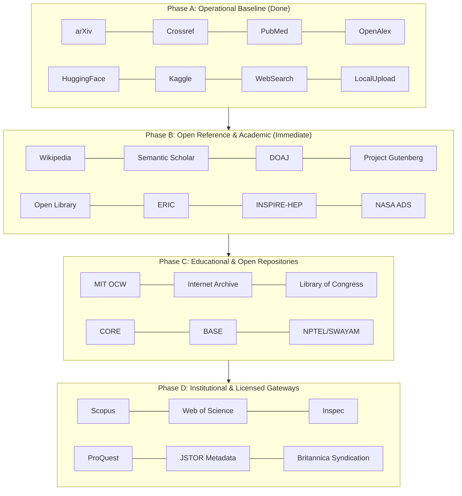

# AXION — Knowledge Source Integration Plan

**Document Version:** 1.0.0  
**Status:** Architecture Proposal & Specification  
**System Target:** AXION Universal Information Acquisition Layer (Components 1–10)  
**Date:** November 18, 2026  

---

## 1. Executive Overview & Objective

The objective of this integration plan is to expand AXION from a repository-dependent research prototype into a **unified, multi-source scientific and educational knowledge acquisition engine**. 

AXION must not exist as ten disconnected applications or isolated scripts. Instead, all external knowledge sources—spanning encyclopedias, multidisciplinary academic indexes, digital book repositories, subject-specific archives, and structured educational platforms—must integrate into **ONE unified platform**. 

Every acquired piece of knowledge must:
1. Be discovered via standard, permitted, official APIs.
2. Be normalized into AXION's canonical `SourceDocument` schema.
3. Preserve strict source provenance, licensing information, and access boundaries.
4. Distinguish epistemic weight (peer-reviewed literature vs. preprints vs. historical texts vs. educational courseware vs. tertiary encyclopedias).
5. Seamlessly feed the existing **Ten Cognitive Components** of AXION without compromising baseline evaluation parity or circumventing security controls.

---

## 2. Source Scope & Categorization

The integration covers 26 major global information sources classified into five distinct operational domains:

```
+----------------------------------------------------------------------------------------------------+
|                                  AXION KNOWLEDGE SOURCE UNIVERSE                                   |
+------------------------------------+---------------------------------------------------------------+
| 1. GENERAL ENCYCLOPEDIAS & REF     | 2. MULTIDISCIPLINARY ACADEMIC SEARCH                          |
|    - Wikipedia (MediaWiki REST)    |    - Semantic Scholar (S2AG Graph API)                        |
|    - Encyclopaedia Britannica*     |    - BASE (Bielefeld Academic Search)                         |
|    - Internet Archive (Metadata)   |    - CORE (Open Access Aggregator)                            |
|    - Library of Congress / WDL     |    - Scopus* (Elsevier Developer API)                         |
|                                    |    - Web of Science* (Clarivate API)                          |
|                                    |    - Google Scholar (User Import / Proxy Policy)             |
+------------------------------------+---------------------------------------------------------------+
| 3. DIGITAL BOOKS & REPOSITORIES    | 4. SUBJECT-SPECIFIC RESEARCH SOURCES                          |
|    - Project Gutenberg (Gutendex)  |    - Science/Physics: arXiv, NASA ADS, INSPIRE-HEP, Inspec*   |
|    - Open Library (Internet Arch)  |    - Medicine/Biology: PubMed, PubMed Central (PMC)           |
|    - DOAJ (Directory of OA Jls)    |    - Humanities/Social: JSTOR*, SSRN*                         |
|    - HathiTrust Digital Library*   |    - Education: ERIC (IES REST API)                           |
|    - NDLI (Nat. Dig. Library India)|    - Dissertations: ProQuest Dissertations & Theses*          |
+------------------------------------+---------------------------------------------------------------+
| 5. STRUCTURED LEARNING & EDUCATIONAL RESOURCES                                                     |
|    - MIT OpenCourseWare (Curriculum API / Archive)                                                 |
|    - Khan Academy (Content API)                                                                    |
|    - Coursera / edX (Catalog & Syllabus Discovery)                                                 |
|    - NPTEL / SWAYAM (Indian National Curriculum Repositories)                                      |
+----------------------------------------------------------------------------------------------------+
(* indicates sources requiring commercial/institutional API keys, licensed access, or metadata-only ingestion)
```

---

## 3. Official API Availability, Authentication & Feasibility Matrix

| Source | Category | Official API / Endpoint | Protocol | Auth Required | Rate Limits | Content Access Permitted |
| :--- | :--- | :--- | :--- | :--- | :--- | :--- |
| **Wikipedia** | General Ref | `en.wikipedia.org/api/rest_v1/` | REST / JSON | None (User-Agent req.) | 200 req/s polite | Full text, summaries (CC-BY-SA) |
| **Britannica** | General Ref | Enterprise Syndication API | REST / XML | Enterprise Key | Contractual | Metadata / Abstract only |
| **Internet Archive** | General Ref | `archive.org/advancedsearch.php` | REST / JSON | Free S3 Keys for bulk | Polite (~5 req/s) | Metadata, Public Domain full text |
| **Library of Congress** | General Ref | `loc.gov/apis/` | REST / JSON | None | 10-20 req/s | Public domain texts, catalog data |
| **Semantic Scholar** | Multi-Acad | `api.semanticscholar.org/graph/v1/` | REST / JSON | Optional (Free Key) | 1 req/s unauth; 10 req/s auth | Paper metadata, abstracts, OA links |
| **BASE** | Multi-Acad | `api.base-search.net/` | REST / JSON | Free IP / Account reg. | Contractual/polite | Metadata, OA document links |
| **CORE** | Multi-Acad | `api.core.ac.uk/v3/` | REST / JSON | Free Developer Key | 10 req/min free | Metadata, full-text OA PDFs |
| **Scopus** | Multi-Acad | `api.elsevier.com/content/search/scopus` | REST / JSON | Institutional API Key | 20,000 req/week | Bibliographic metadata, abstracts |
| **Web of Science** | Multi-Acad | `api.clarivate.com/apis/wos-starter/v1` | REST / JSON | Institutional API Key | Contractual | High-impact citations & metadata |
| **Google Scholar** | Multi-Acad | *No Official Public API* | N/A | Scraping Forbidden | Aggressive Block | Manual BibTeX / User PDF Import |
| **Project Gutenberg** | Books/Repos | `gutendex.com/books` | REST / JSON | None | Unlimited polite | Full text (Public Domain) |
| **Open Library** | Books/Repos | `openlibrary.org/search.json` | REST / JSON | None | 10 req/s polite | Book metadata, ISBN, borrow links |
| **DOAJ** | Books/Repos | `doaj.org/api/v2/search/articles` | REST / JSON | None | Polite | Peer-reviewed OA metadata & links |
| **HathiTrust** | Books/Repos | `catalog.hathitrust.org/api/volumes` | REST / JSON | Free bib; Auth data | Polite | Bibliographic; Full text for PD |
| **NDLI** | Books/Repos | NDLI National Institutional API | REST / OAI-PMH | Partner Credentials | Polite | Metadata, Open Educational Content |
| **arXiv** *(Done)* | Science | `export.arxiv.org/api/query` | Atom / XML | None | 1 req/3s | Full preprints, abstracts, OA PDFs |
| **NASA ADS** | Science | `api.adsabs.harvard.edu/v1/search` | REST / JSON | Free API Token | 5,000 req/day | Astrophysics, physics abstracts & OA |
| **INSPIRE-HEP** | Science | `inspirehep.net/api/literature` | REST / JSON | None | 15 req/s | High Energy Physics literature & OA |
| **Inspec** | Science | IET / Engineering Village API | REST / JSON | Commercial Key | Contractual | Engineering metadata & abstracts |
| **PubMed** *(Done)*| Medicine | `eutils.ncbi.nlm.nih.gov/entrez/eutils`| REST / XML | Optional NCBI Key | 3 req/s (10 w/ key) | Biomedical abstracts & citations |
| **PMC** | Medicine | `eutils.ncbi.nlm.nih.gov/entrez/eutils`| REST / XML | Optional NCBI Key | 3 req/s (10 w/ key) | Full-text open access biomedical XML |
| **ERIC** | Education | `api.ies.ed.gov/eric/` | REST / JSON | None | Polite | Education metadata, abstracts, OA PDFs |
| **JSTOR** | Humanities | Constellate / Data for Research | REST / OAI-PMH | Institutional Key | Contractual | Metadata, user-uploaded PDFs |
| **SSRN** | Humanities | Crossref / OpenAlex feeds | REST / JSON | Via aggregator | Rate-governed | Social science working paper metadata |
| **ProQuest** | Dissertations| ProQuest TDM / PQDT Open API | REST / JSON | Institutional Key | Contractual | Dissertation abstracts & OA theses |
| **MIT OCW** | Learning | `ocw.mit.edu/api/v1/` & Open Archive | REST / JSON | None | Polite | Syllabi, lecture notes, transcripts |
| **Khan Academy** | Learning | Khan Academy Topic Tree API | REST / JSON | None | Polite | Video transcripts, structured exercises|
| **NPTEL/SWAYAM**| Learning | NPTEL Open Course Catalog Feed | REST / JSON | None | Polite | Technical lecture transcripts & syllabi|

---

## 4. Integration with AXION's Ten Cognitive Components

Every source connector outputs standard `SourceDocument` instances that feed the 10 components without introducing side effects or unearned evaluation advantages:

```
+-------------------------------------------------------------------------------------------------------+
|                                  AXION 10-COMPONENT INTEGRATION                                       |
+------------------------------------+------------------------------------------------------------------+
| 1. PDF Research Reader             | Parses and extracts full text, section headings, and equations   |
|                                    | from open-access PDFs downloaded from arXiv, CORE, ERIC, DOAJ.   |
+------------------------------------+------------------------------------------------------------------+
| 2. Scientific Knowledge Graph      | Entity and relation extractors populate domain subgraphs from     |
|                                    | abstracts, encyclopedic definitions, and textbook taxonomies.    |
+------------------------------------+------------------------------------------------------------------+
| 3. Research Assistant (Baseline)   | Retrieves evidence via dense vector similarity over ingested     |
|                                    | chunks under strictly identical conditions to the AXION engine.  |
+------------------------------------+------------------------------------------------------------------+
| 4. Simple Hypothesis Tester        | Tests elementary correlational hypotheses against acquired       |
|                                    | datasets and factual literature claims.                          |
+------------------------------------+------------------------------------------------------------------+
| 5. Reasoning System                | Distinguishes evidence tiers (e.g. peer-reviewed vs. tertiary);  |
|                                    | traces causal dependency trees across multiple references.       |
+------------------------------------+------------------------------------------------------------------+
| 6. Cross-Domain Solver             | Discovers cross-domain analogies and structural mappings across  |
|                                    | physics, engineering, biology, and computational mathematics.    |
+------------------------------------+------------------------------------------------------------------+
| 7. Hypothesis Generator            | Proposes novel cross-domain mechanisms constrained by empirical  |
|                                    | evidence gathered from scholarly search engines.                 |
+------------------------------------+------------------------------------------------------------------+
| 8. Full Hypothesis Tester          | Executes sandboxed numerical, symbolic, and ODE validations on   |
|                                    | scientific equations extracted from academic literature.         |
+------------------------------------+------------------------------------------------------------------+
| 9. Validated Memory                | Persists verified cross-domain findings across system restarts   |
|                                    | while retaining full bibliographic provenance pointers.          |
+------------------------------------+------------------------------------------------------------------+
| 10. AXION Prototype UI             | Provides a minimal, unified interface for cross-source search,   |
|                                    | source health monitoring, and manual document ingestion.         |
+-------------------------------------------------------------------------------------------------------+
```

---

## 5. Architectural Principles & Operational Safeguards

1. **Zero Web Scraping Violations:** No CAPTCHAs, bot gates, or anti-scraping protections will be bypassed. Sources lacking official public APIs (e.g. Google Scholar) are supported solely through permitted metadata aggregators, user file uploads, or documented institutional proxies.
2. **Honest Content Boundary Reporting:** When full text is inaccessible due to licensing, the connector sets `access_status = AccessStatus.ABSTRACT_ONLY` or `METADATA_ONLY` and `is_full_text = False`. The system never claims to possess content it has not ingested.
3. **Epistemic Integrity Tiering:** Every document carries a strict `TrustTier`:
   - `PEER_REVIEWED`: Verified scholarly journals (Crossref, DOAJ, Scopus, PubMed).
   - `PREPRINT`: Non-peer-reviewed academic preprints (arXiv, bioRxiv).
   - `ACADEMIC_CURRICULUM`: Vetted university materials (MIT OCW, NPTEL).
   - `TERTIARY_REFERENCE`: Encyclopedias and general references (Wikipedia, Open Library).
   - `PUBLIC_ARCHIVE`: Digitized historical books and manuscripts (Project Gutenberg, LOC).
4. **Credential Isolation:** All API credentials (`NASA_ADS_API_KEY`, `SEMANTIC_SCHOLAR_API_KEY`, `CORE_API_KEY`, `ELSEVIER_API_KEY`) are managed strictly via system environment variables and `.env`. Zero keys are stored in source code.

---

## 6. Phased Implementation Roadmap



- **Phase A (Current Complete):** 8 core connectors fully operational with 85 unit tests.
- **Phase B (Proposed Next Step):** Implement 8 open, highly reliable REST connectors (`wikipedia`, `semantic_scholar`, `doaj`, `project_gutenberg`, `open_library`, `eric`, `inspire_hep`, `nasa_ads`).
- **Phase C:** Implement educational platforms (`mit_ocw`, `nptel_swayam`), digital libraries (`internet_archive`, `loc_wdl`), and federated aggregators (`core`, `base`).
- **Phase D:** Implement authenticated enterprise connectors (`scopus`, `wos`, `inspec`, `proquest`) providing metadata and abstract ingestion for institutions with active licenses.

---

## 7. Approval Gate & Next Actions

In accordance with system directives, this plan is submitted for review prior to introducing changes beyond the currently accepted Phase A/Universal Acquisition engine. Upon authorization, implementation will commence systematically starting with Phase B.
