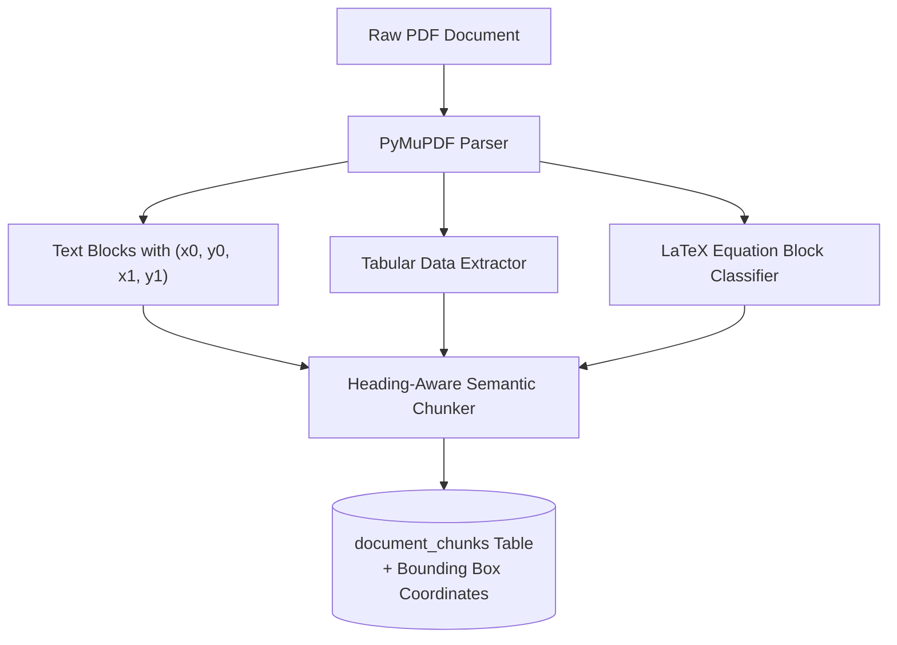
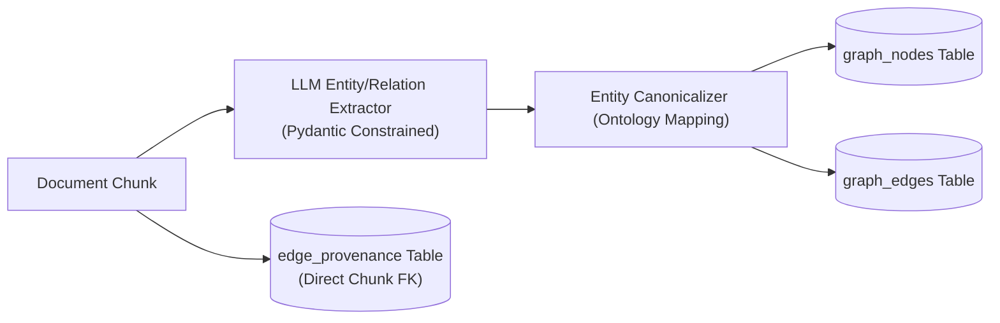
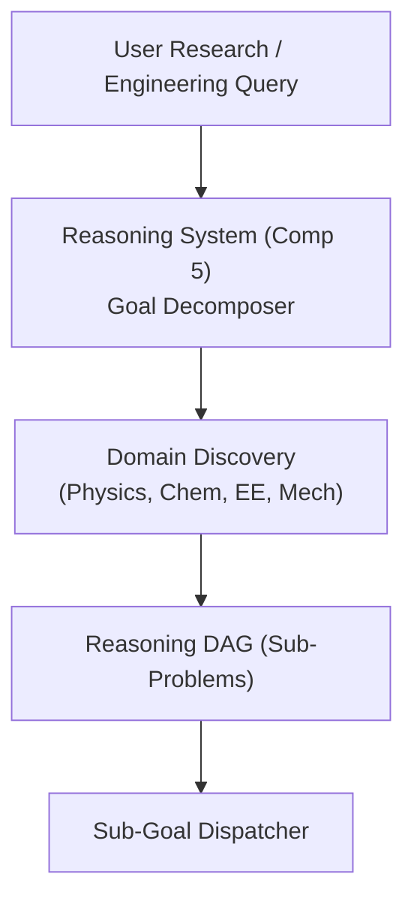
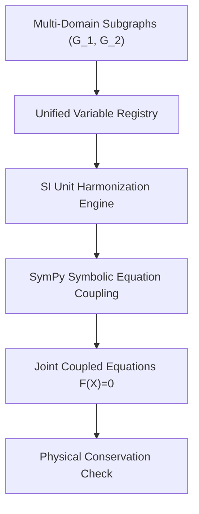
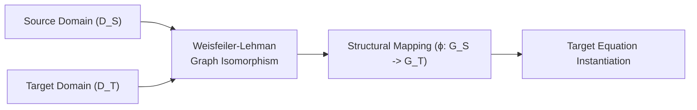
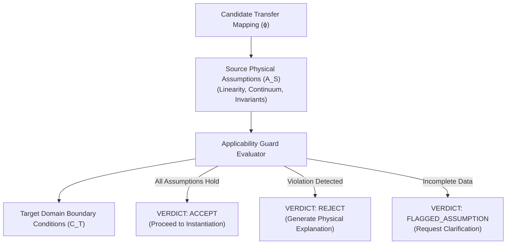
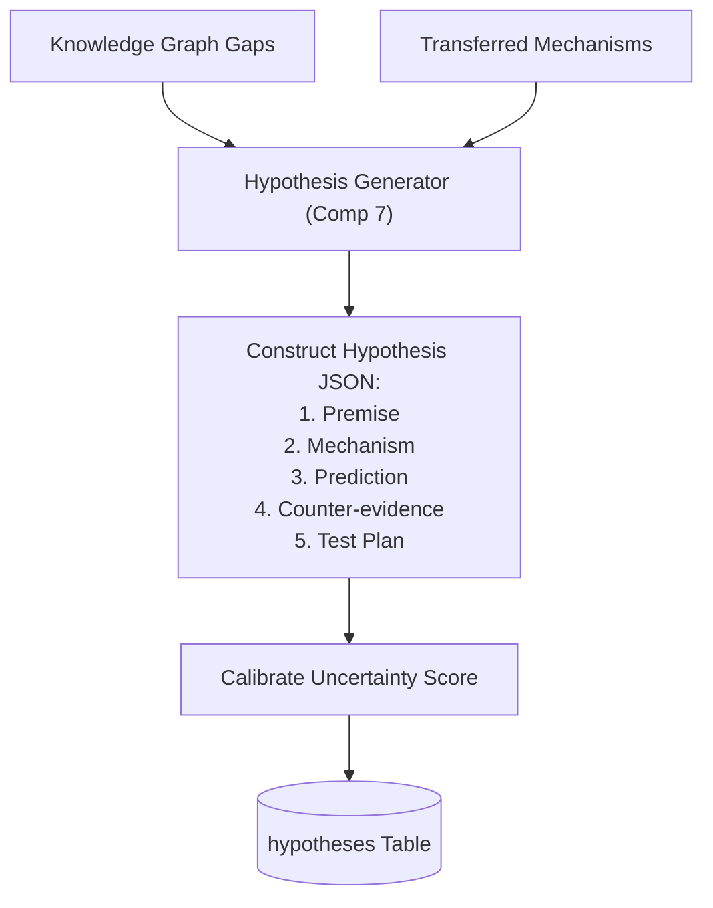
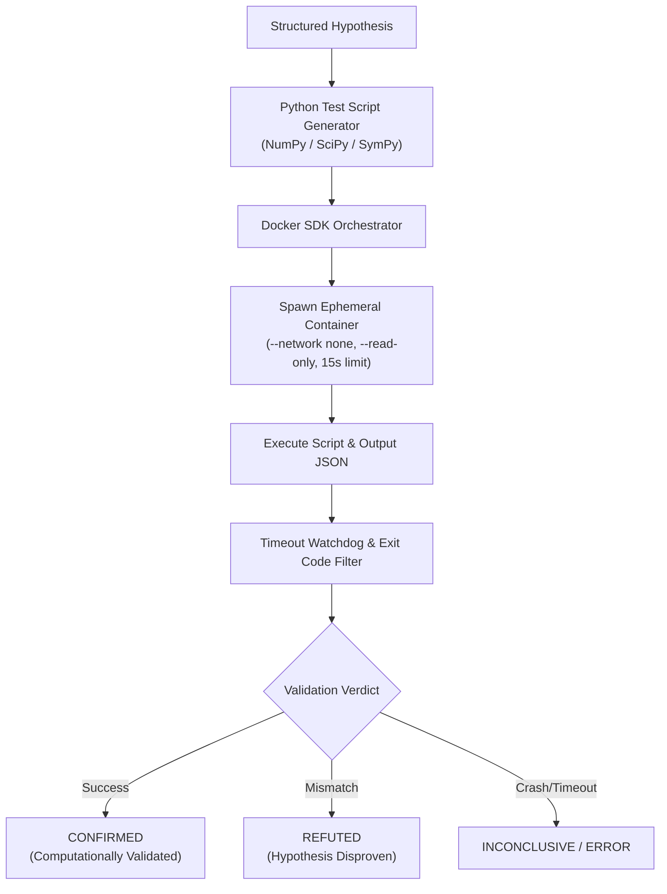
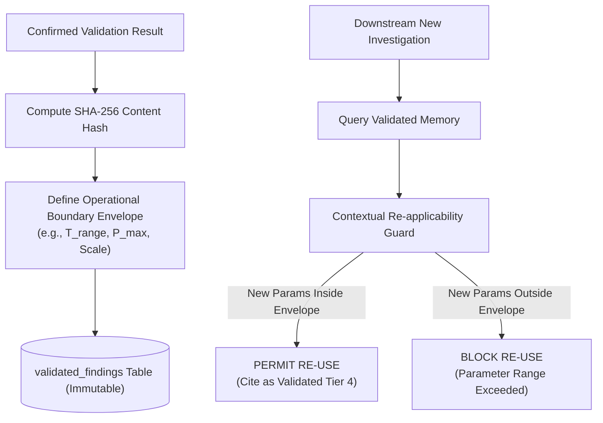
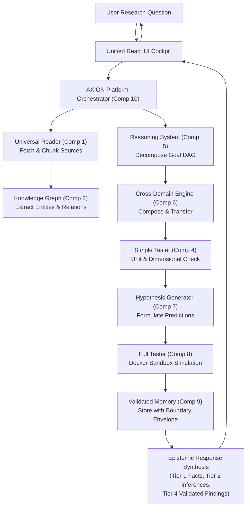

# AXION — System Architecture & Engineering Blueprint

**Document Version:** 2.0.0  
**Date:** November 18, 2026  
**Status:** Approved for Phase 0 Specification  
**Project:** AXION — Universal Knowledge and Cross-Domain Intelligence Platform  

---

## 1. Architectural Philosophy & Core Principles

AXION is designed as an **evidence-guided universal knowledge and problem-solving engine**. Its architecture rests upon six fundamental engineering principles:

1. **Decoupled Epistemic Tiers:** Explicit operational boundaries between factual extraction, relational topology, neuro-symbolic reasoning, and empirical execution.
2. **Modular Micro-Kernel Architecture:** Core engines (Ingestion, Graph, Reasoner, Transfer, Sandbox, Memory) communicate through typed Pydantic contracts and REST/WebSocket interfaces.
3. **Provider-Agnostic AI Integration:** Foundation LLMs are treated as replaceable computational components accessed exclusively through an abstract adapter layer.
4. **Zero-Trust Computational Execution:** All dynamically generated code, equations, and simulations run in ephemeral, unprivileged, non-networked Docker containers.
5. **Bidirectional Provenance Traceability:** Every concept, relation, derivation, and numerical value carries an immutable pointer back to primary source coordinates or execution logs.
6. **Physical & Mathematical Safety:** Automated guards check physical constraints (conservation laws, thermodynamic limits, dimensional balance) and flag high-risk real-world procedures.

---

## 2. High-Level System Architecture & Layered Decomposition

```
+----------------------------------------------------------------------------------------------------+
|                             PRESENTATION LAYER (React 19 + TypeScript)                             |
|  +----------------------------------------------------------------------------------------------+  |
|  | 11 Dedicated Research Cockpit Views:                                                         |  |
|  | [1. Home] [2. Research Workspace] [3. Knowledge Explorer] [4. Cross-Domain Intelligence]     |  |
|  | [5. Research Assistant] [6. Problem Solver] [7. Hypothesis Lab] [8. Experiment & Validation]  |  |
|  | [9. Validated Memory] [10. Sources & Evidence] [11. Settings & Benchmarks]                    |  |
|  +----------------------------------------------------------------------------------------------+  |
|  | Visualization: Cytoscape.js (Graphs), KaTeX (Math), Plotly (Simulation), Monaco (Code Editor)|  |
+----------------------------------------------------------------------------------------------------+
                                      |  HTTP/JSON (REST API) & WebSockets
                                      v
+----------------------------------------------------------------------------------------------------+
|                               APPLICATION ORCHESTRATION LAYER (FastAPI)                            |
|  +----------------------------------------------------------------------------------------------+  |
|  | API Gateways, Security Middleware, Rate Limiting, Input Sanitization, Auth & Isolation       |  |
|  +----------------------------------------------------------------------------------------------+  |
|  | Subsystem Controllers (The 10 Components):                                                   |  |
|  | - Comp 1: Universal Knowledge Reader & Source Connectors                                      |  |
|  | - Comp 2: Scientific & Cross-Domain Knowledge Graph Engine                                    |  |
|  | - Comp 3: Research Assistant Baseline Controller (Conventional Control System)                |  |
|  | - Comp 4: Simple Hypothesis Tester & Dimensional Analysis Engine                              |  |
|  | - Comp 5: Reasoning System & Goal Decomposition Engine                                        |  |
|  | - Comp 6: Cross-Domain Composition & Transfer Engine [CENTRAL RESEARCH CORE]                 |  |
|  | - Comp 7: Hypothesis Generator & Structured Conjecture Engine                                |  |
|  | - Comp 8: Full Hypothesis Tester & Containerized Simulation Orchestrator                     |  |
|  | - Comp 9: Validated Knowledge Memory Manager & Re-applicability Guard                         |  |
|  | - Comp 10: Complete AXION Platform Orchestrator & Automated Benchmark Runner                 |  |
|  +----------------------------------------------------------------------------------------------+  |
|  | Provider-Agnostic LLM Adapter: OpenAI | Anthropic | Gemini | Local vLLM                      |  |
+----------------------------------------------------------------------------------------------------+
                               |                                 |
              SQLAlchemy 2.0   |                                 | Ephemeral Docker IPC
                               v                                 v
+-------------------------------------------+   +----------------------------------------------------+
|            PERSISTENCE LAYER              |   |          ISOLATED EXECUTION SANDBOX                |
|  +-------------------------------------+  |   |  +----------------------------------------------+  |
|  | PostgreSQL 16                       |  |   |  | Docker Ephemeral Container Worker            |  |
|  | - Relational Entities & Relations   |  |   |  | - Non-root user (nobody)                      |  |
|  | - Document Chunks & Layout Maps     |  |   |  | - Network disabled (--network none)          |  |
|  | - Validated Memory & Re-use Logs    |  |   |  | - Read-only root filesystem                  |  |
|  +-------------------------------------+  |   |  | - 128 MB RAM tmpfs scratchpad                |  |
|  | pgvector Extension                  |  |   |  | - SciPy, NumPy, SymPy, Pandas, Matplotlib    |  |
|  | - Chunk Embeddings (HNSW index)     |  |   |  | - 15-second hard watchdog timer              |  |
|  +-------------------------------------+  |   |  +----------------------------------------------+  |
|  | Local / Cloud Object Storage        |  |   +----------------------------------------------------+
|  | - Original Source PDFs & Datasets   |  |
|  +-------------------------------------+  |
+-------------------------------------------+
```

---

## 3. Technology Evaluation Matrix (Part 5 Requirements)

Every technology choice in AXION has been evaluated across seven strict criteria:

```
+------------------+-----------------------+-----------------------+-----------------------+-----------------------+------------+
| TECHNOLOGY       | WHAT IT DOES          | ADVANTAGES            | LIMITATIONS           | ALTERNATIVES          | PHASE      |
+------------------+-----------------------+-----------------------+-----------------------+-----------------------+------------+
| Python 3.14      | Backend & AI language | Vast scientific AI &  | Slower execution for  | Rust, Go, C++         | Phase 1-5  |
|                  | runtime.              | math ecosystem.       | raw CPU loops.        | (FFI extensions later)|            |
+------------------+-----------------------+-----------------------+-----------------------+-----------------------+------------+
| FastAPI          | Async API framework   | High concurrency,     | Requires async        | Flask, Django,        | Phase 1-5  |
|                  | & OpenAPI generator.  | Pydantic v2 typing.   | discipline.           | Express.js            |            |
+------------------+-----------------------+-----------------------+-----------------------+-----------------------+------------+
| Pydantic v2      | Data validation &     | Ultra-fast C-core,    | Strict schema design  | Marshmallow,          | Phase 1-5  |
|                  | schema enforcement.   | JSON Schema export.   | required upfront.     | TypedDict, Cerberus   |            |
+------------------+-----------------------+-----------------------+-----------------------+-----------------------+------------+
| SQLAlchemy 2.0   | Async ORM & SQL       | Type-safe queries,    | Learning curve for    | Tortoise-ORM,         | Phase 1-5  |
|                  | relational engine.    | asyncpg driver.       | advanced recursive CTE| Prisma Python, Peewee |            |
+------------------+-----------------------+-----------------------+-----------------------+-----------------------+------------+
| React 19 + TS    | Frontend UI           | Component reusability,| Client-side state     | Vue, Svelte,          | Phase 1-5  |
|                  | framework.            | compile-time typing.  | management overhead.  | SolidJS               |            |
+------------------+-----------------------+-----------------------+-----------------------+-----------------------+------------+
| Tailwind CSS     | Utility-first styling | Rapid research cockpit| Large HTML class      | CSS Modules,          | Phase 1-5  |
|                  | design system.        | UI composition.       | strings.              | Styled Components     |            |
+------------------+-----------------------+-----------------------+-----------------------+-----------------------+------------+
| PostgreSQL 16    | Unified ACID relational| Rock-solid ACID, JSONB| Slower than pure      | MySQL, SQLite,        | Phase 1-5  |
|                  | database.             | & recursive CTEs.     | in-memory for micro-op| Mongo                 |            |
+------------------+-----------------------+-----------------------+-----------------------+-----------------------+------------+
| pgvector         | High-dimensional      | Zero-overhead vector  | Slightly slower index | Pinecone, Qdrant,     | Phase 1-5  |
|                  | vector search.        | joins in PostgreSQL.  | build than Pinecone.  | Milvus, Weaviate      |            |
+------------------+-----------------------+-----------------------+-----------------------+-----------------------+------------+
| NetworkX         | In-memory graph       | Rich graph algorithms | RAM-limited           | Neo4j, Memgraph,      | Phase 1-5  |
|                  | algorithm library.    | (WL, PageRank, paths).| ($> 10^6$ nodes).     | igraph, Rustworkx     |            |
+------------------+-----------------------+-----------------------+-----------------------+-----------------------+------------+
| PyMuPDF (fitz)   | High-speed PDF        | Blazing fast, precise | No native OCR for     | PyPDF, pdfminer,      | Phase 1-5  |
|                  | parsing & bounding-box| bounding-box coords.  | scanned bitmaps.      | PDFPlumber, Tesseract |            |
+------------------+-----------------------+-----------------------+-----------------------+-----------------------+------------+
| Docker Engine    | Isolated container    | Kernel namespace &    | 200ms spin-up overhead| Wasm (Pyodide),       | Phase 4-5  |
|                  | execution sandbox.    | resource isolation.   | per execution.        | gVisor, Firecracker   | (Sims)     |
+------------------+-----------------------+-----------------------+-----------------------+-----------------------+------------+
| SymPy            | Symbolic mathematics  | Exact algebra, units, | Slower than numerical | Maxima, Wolfram Engine| Phase 2-5  |
|                  | & dimensional checks. | symbolic reductions.  | solvers on large sets.| (Pint for units)      | (Units)    |
+------------------+-----------------------+-----------------------+-----------------------+-----------------------+------------+
| Pytest           | Automated test        | Parametrized tests,   | Requires mocking      | Unittest,             | Phase 1-5  |
|                  | framework.            | rich plugin ecosystem.| async database setups.| Nose2                 |            |
+------------------+-----------------------+-----------------------+-----------------------+-----------------------+------------+
```

---

## 4. Component 6 Deep Dive: The 14 Stages of Knowledge Composition & Transfer

Component 6 is AXION's core research engine. We analyze its 14 investigational stages in exhaustive detail:

```
+----------------------------------------------------------------------------------------------------+
| STAGE 1: Problem Understanding                                                                     |
| - Input: Raw natural language user query / engineering goal.                                       |
| - Output: Formal Problem Specification object (Goal, Constraints, Target Variables, Units).        |
| - Purpose: Parse implicit assumptions and isolate the technical objective.                        |
| - Algorithms: Pydantic-constrained LLM parsing with dependency tree extraction.                    |
| - Failure Cases: Ambiguous user intent, ill-posed physical goals.                                  |
| - Evaluation: Intent classification accuracy and constraint extraction recall against ground truth.|
+----------------------------------------------------------------------------------------------------+
| STAGE 2: Domain Identification                                                                     |
| - Input: Formal Problem Specification.                                                             |
| - Output: Ranked set of relevant scientific and engineering domains {D_1, D_2, ..., D_k}.          |
| - Purpose: Identify all disciplines governing the problem (e.g. thermodynamics, kinematics, PV).   |
| - Algorithms: Multi-label domain classifier + taxonomic entity expansion.                          |
| - Failure Cases: Overlooking a critical coupling domain (e.g., forgetting battery thermal limits). |
| - Evaluation: Multi-label precision and recall against human expert domain annotations.            |
+----------------------------------------------------------------------------------------------------+
| STAGE 3: Multi-Source Knowledge Retrieval                                                          |
| - Input: Domain tags, entity keywords, semantic goal embeddings.                                   |
| - Output: Attributed candidate chunks, data tables, and API responses.                             |
| - Purpose: Retrieve verified evidence across multiple connected repositories.                     |
| - Algorithms: Hybrid retrieval: Dense vector search (pgvector) + Lexical BM25 + KG seed entities.  |
| - Failure Cases: Missing papers, retrieval of outdated or low-trust sources.                       |
| - Evaluation: Mean Reciprocal Rank (MRR) and Recall@k against gold evidence sets.                  |
+----------------------------------------------------------------------------------------------------+
| STAGE 4: Concept Normalization & Canonicalization                                                  |
| - Input: Raw extracted entities and terms across disparate sources.                                |
| - Output: Canonical concepts mapped to standard ontologies (e.g., QUDT for units, Wikidata/ChEBI). |
| - Purpose: Prevent synonym duplication (e.g. "heat flux", "thermal transfer rate").                |
| - Algorithms: String distance (Levenshtein), embedding clustering, ontology entity linking.        |
| - Failure Cases: Incorrect synonym merging across homonyms (e.g. "charge" in battery vs physics).  |
| - Evaluation: Entity linking precision and cluster purity.                                         |
+----------------------------------------------------------------------------------------------------+
| STAGE 5: Domain Subgraph Representation                                                            |
| - Input: Canonical entities, extracted relations, and document citations.                          |
| - Output: Instantiated domain concept subgraphs G_1, G_2, ..., G_k in NetworkX / PostgreSQL.       |
| - Purpose: Model structural topology, causal directionality, and parameter dependencies.           |
| - Algorithms: Relational graph construction, edge provenance binding.                              |
| - Failure Cases: Incoherent relation extraction, disconnected components.                          |
| - Evaluation: Graph density, connectivity, and edge extraction precision.                          |
+----------------------------------------------------------------------------------------------------+
| STAGE 6: Latent Relationship Identification                                                        |
| - Input: Distinct domain subgraphs.                                                                |
| - Output: Candidate inter-domain relational edges (e.g., Cation Doping -> Lattice Strain).         |
| - Purpose: Discover hidden bridges between concepts that share no surface keywords.               |
| - Algorithms: Common neighbor pathfinding, transitive closure, graph embedding link prediction.     |
| - Failure Cases: False positive spurious links, hallucinated causal directions.                    |
| - Evaluation: Link prediction precision against known scientific discoveries.                     |
+----------------------------------------------------------------------------------------------------+
| STAGE 7: Cross-Domain Alignment & Analogy Discovery                                                |
| - Input: Source Subgraph G_S and Target Subgraph G_T.                                              |
| - Output: Candidate structural morphism phi: G_S -> G_T.                                           |
| - Purpose: Find abstract structural equivalences (e.g. Fluid Hagen-Poiseuille <-> Ohm's Law).      |
| - Algorithms: Weisfeiler-Lehman (WL) graph kernel isomorphism, relational signature matching.      |
| - Failure Cases: Superficially matching graphs with completely different physical meanings.        |
| - Evaluation: Precision of identified structural analogies against historical scientific analogies.|
+----------------------------------------------------------------------------------------------------+
| STAGE 8: Composition Planning                                                                      |
| - Input: Aligned multi-domain subgraphs, problem constraints.                                      |
| - Output: Directed composition execution plan (DAG of variable mappings and equation joins).       |
| - Purpose: Order the steps required to couple equations from different fields.                     |
| - Algorithms: Topological sort, dependency graph analysis.                                         |
| - Failure Cases: Circular equation dependencies, under-constrained parameter sets.                 |
| - Evaluation: Plan validity (acyclicity, solvability).                                             |
+----------------------------------------------------------------------------------------------------+
| STAGE 9: Multi-Domain Knowledge Composition                                                        |
| - Input: Composition plan, domain governing equations, variable definitions.                       |
| - Output: Joint coupled system of governing equations F_joint(X) = 0 with unified SI units.        |
| - Purpose: Unify equations across fields (e.g. coupling solar irradiance to motor torque demand).  |
| - Algorithms: Symbolic substitution, unit harmonization (SymPy), variable registry binding.        |
| - Failure Cases: Unit dimensional mismatch (e.g., adding Watts to Joules), inconsistent notation.  |
| - Evaluation: SymPy dimensional homogeneity score (100% required).                                 |
+----------------------------------------------------------------------------------------------------+
| STAGE 10: Knowledge Transfer Mapping                                                               |
| - Input: Candidate analogy phi, source principle e_S, target problem context.                      |
| - Output: Transferred candidate model or mechanism instantiated in target variables.               |
| - Purpose: Project a solution mechanism from an established field to an unfamiliar problem.        |
| - Algorithms: Homomorphic equation transformation, parameter re-instantiation.                     |
| - Failure Cases: Inappropriate variable binding, loss of boundary constants.                       |
| - Evaluation: Semantic and functional coherence in target domain.                                  |
+----------------------------------------------------------------------------------------------------+
| STAGE 11: Formal Applicability Checking (The Applicability Guard)                                  |
| - Input: Source assumptions A_S, target domain conditions C_T.                                     |
| - Output: Verdict: {ACCEPT, REJECT, FLAGGED_ASSUMPTION} with formal rationale.                     |
| - Purpose: Verify whether the transferred law's physical assumptions hold in the target context.   |
| - Algorithms: First-order logical theorem proving, constraint satisfaction checking.               |
| - Failure Cases: Accepting invalid analogies (e.g., using continuum fluid law for nanoscale pores).|
| - Evaluation: Unsound transfer rejection accuracy on negative test cases (>= 90% required).        |
+----------------------------------------------------------------------------------------------------+
| STAGE 12: Constraint & Physical Boundary Verification                                              |
| - Input: Composed system of equations, physical boundary limits.                                   |
| - Output: Verified feasible parameter space or constraint violation alerts.                        |
| - Purpose: Ensure proposed solution obeys universal conservation laws and thermodynamic bounds.   |
| - Algorithms: Interval arithmetic, Karush-Kuhn-Tucker (KKT) conditions, bound checking.           |
| - Failure Cases: Proposing efficiency > 100%, negative absolute temperature, mass non-conservation|
| - Evaluation: Violation detection rate on physically impossible test inputs (100% required).      |
+----------------------------------------------------------------------------------------------------+
| STAGE 13: Solution Construction & Step-by-Step Explanation                                         |
| - Input: Composed equations, validated transfer mappings, numerical parameter values.              |
| - Output: Structured solution: Mathematical derivation, Component sizing, Step-by-step build guide |
| - Purpose: Deliver an actionable, understandable technical solution explaining both WHAT and WHY.  |
| - Algorithms: Hierarchical explanation generation, KaTeX formatting, provenance linking.           |
| - Failure Cases: Jargon-heavy unreadable prose, omitting critical assembly steps.                  |
| - Evaluation: Expert human clarity rating, step completeness.                                      |
+----------------------------------------------------------------------------------------------------+
| STAGE 14: Evidence Validation & Provenance Binding                                                 |
| - Input: Final solution, all used source chunks, sandbox execution traces.                         |
| - Output: Fully attributed Solution Artifact with Epistemic Tier tags and verifiable citations.    |
| - Purpose: Certify that every claim is grounded in primary evidence or empirical validation.       |
| - Algorithms: Sentence-level NLI entailment check, bounding-box coordinate linking.                 |
| - Failure Cases: Orphan claims lacking citations, hallucinated page numbers.                       |
| - Evaluation: Citation precision (>= 95%) and unsupported claim rate (<= 5%).                      |
+----------------------------------------------------------------------------------------------------+
```

---

## 5. Objective Comparison of Technical Approaches (Part 4 Requirements)

We objectively evaluate 11 prominent AI and reasoning paradigms to justify AXION's neuro-symbolic hybrid approach:

```
+-------------------------------------+---------------------------------------------------------------+---------------------------------------------------------------+----------------------------------+
| APPROACH                            | STRENGTHS                                                     | LIMITATIONS & RISKS                                           | AXION ROLE                       |
+-------------------------------------+---------------------------------------------------------------+---------------------------------------------------------------+----------------------------------+
| 1. Knowledge Graphs                 | Explicit relational structure, transparent traversal,         | Expensive to construct manually; vulnerable to extraction     | Core structural backbone         |
|                                     | excellent for multi-hop provenance tracking.                  | noise from LLMs.                                              | (Component 2).                   |
+-------------------------------------+---------------------------------------------------------------+---------------------------------------------------------------+----------------------------------+
| 2. Formal Ontologies                | Unambiguous semantics, formal reasoning (OWL/DL),             | Extremely rigid, difficult to scale across fast-moving        | Normalized taxonomies for        |
|                                     | automated consistency checking.                               | multi-disciplinary scientific frontiers.                      | units and entity classes.        |
+-------------------------------------+---------------------------------------------------------------+---------------------------------------------------------------+----------------------------------+
| 3. Semantic Embeddings              | Fast approximate similarity matching across unstructured text;| Measures topical lexical similarity, not causal or structural | Initial candidate retrieval seed |
|                                     | language-agnostic.                                            | dependencies; fails on cross-domain vocabulary shifts.        | (Component 3).                   |
+-------------------------------------+---------------------------------------------------------------+---------------------------------------------------------------+----------------------------------+
| 4. Graph-Based Reasoning            | Topological path analysis, cycle detection, multi-hop         | Incomplete graphs lead to dead ends; exponential path growth  | Query decomposition and bridge   |
|                                     | reachability.                                                 | if unconstrained.                                             | discovery (Components 5 & 6).    |
+-------------------------------------+---------------------------------------------------------------+---------------------------------------------------------------+----------------------------------+
| 5. Analogical Reasoning (SME)       | Maps relational structures across domains independent of      | High algorithmic complexity ($O(N^k)$); struggles with noisy  | Core mechanism for structural    |
|                                     | surface attributes (Structure Mapping Engine).                | unstructured text.                                            | transfer (Component 6).          |
+-------------------------------------+---------------------------------------------------------------+---------------------------------------------------------------+----------------------------------+
| 6. Case-Based Reasoning (CBR)       | Reuses past validated solutions to solve new problems;        | Requires large case libraries; struggles when target domain   | Validated Memory reuse engine    |
|                                     | retains experiential knowledge.                               | has novel physics.                                            | (Component 9).                   |
+-------------------------------------+---------------------------------------------------------------+---------------------------------------------------------------+----------------------------------+
| 7. Rule-Based Systems               | 100% deterministic, explainable, easy to verify.              | Brittle; combinatorial explosion of rules; cannot handle      | Simple Tester & Applicability    |
|                                     |                                                               | novelty or edge cases gracefully.                             | Guard (Components 4 & 6).        |
+-------------------------------------+---------------------------------------------------------------+---------------------------------------------------------------+----------------------------------+
| 8. Constraint-Based Reasoning       | Perfect for physical feasibility, unit checking, and          | Cannot generate novel hypotheses; requires complete           | Feasibility and boundary checking|
|                                     | conservation bounds.                                          | mathematical problem formulation.                             | (Components 4 & 8).              |
+-------------------------------------+---------------------------------------------------------------+---------------------------------------------------------------+----------------------------------+
| 9. Pure Retrieval (Standard RAG)    | Fast, simple, leverages pre-existing document databases.      | Zero synthesis, no unit harmonization, no cross-domain        | Maintained strictly as Control   |
|                                     |                                                               | transfer, high hallucination on multi-hop queries.            | Baseline (Component 3).          |
+-------------------------------------+---------------------------------------------------------------+---------------------------------------------------------------+----------------------------------+
| 10. Pure LLM-Assisted Reasoning     | Highly fluent, flexible natural language understanding,       | Frequent hallucinations, flat epistemic confidence, cannot    | Extraction and hypothesis        |
|                                     | broad commonsense knowledge.                                  | perform reliable multi-step math or physical simulation.      | formulation assistant.           |
+-------------------------------------+---------------------------------------------------------------+---------------------------------------------------------------+----------------------------------+
| 11. Hybrid Neuro-Symbolic           | Combines LLM semantic flexibility for extraction/conjecture   | Higher architectural orchestration complexity.                | **SELECTED PRIMARY PARADIGM      |
|     (AXION Architecture)            | with symbolic/computational engines for rigorous validation.  |                                                               | FOR THE AXION PLATFORM**         |
+-------------------------------------+---------------------------------------------------------------+---------------------------------------------------------------+----------------------------------+
```

---

## 6. Knowledge Source Strategy & Connector Architecture (Part 7 Requirements)

AXION employs an open, modular connector architecture supporting eight distinct knowledge sources:

```
+------------------------------------+--------------------------------+--------------------+---------------------+-----------------------------+
| SOURCE CATEGORY                    | EXAMPLE PROVIDERS / REPOS      | ACCESS METHOD      | DATA FORMAT         | LICENSING & ATTRIBUTION     |
+------------------------------------+--------------------------------+--------------------+---------------------+-----------------------------+
| 1. Online Search & Web             | Tavily, DuckDuckGo, Bing API   | REST API / JSON    | HTML (Readability), | Respect robots.txt, display |
|                                    |                                |                    | Markdown            | full source URL & date.     |
+------------------------------------+--------------------------------+--------------------+---------------------+-----------------------------+
| 2. Open Scientific Literature      | ArXiv, PubMed Central, DOAJ    | OAI-PMH, REST APIs | PDF, XML,           | Open Access (CC-BY, CC0),   |
|                                    |                                |                    | LaTeX source        | author, DOI, page bounds.   |
+------------------------------------+--------------------------------+--------------------+---------------------+-----------------------------+
| 3. Public Scientific Datasets      | NASA PDS, Materials Project,   | REST APIs, direct  | CSV, JSON, HDF5,    | Public Domain, attribution  |
|                                    | PubChem, NIST WebBook          | download           | Parquet             | citation required.          |
+------------------------------------+--------------------------------+--------------------+---------------------+-----------------------------+
| 4. Technical Documentation         | MDN, ReadTheDocs, RFC Editor,  | Scraper / Git repo | Markdown, HTML      | Open documentation licenses |
|                                    | Manufacturer Whitepapers       |                    |                     | (MIT, CC-BY-SA).            |
+------------------------------------+--------------------------------+--------------------+---------------------+-----------------------------+
| 5. Educational Resources           | MIT OpenCourseWare, OpenStax   | Direct / Web       | PDF, EPUB, Web      | CC-BY-NC-SA, non-commercial |
|                                    |                                |                    |                     | educational use tracking.   |
+------------------------------------+--------------------------------+--------------------+---------------------+-----------------------------+
| 6. Structured Databases            | Wikidata, ConceptNet, ChEBI,   | SPARQL, REST, SQL  | RDF, Triple-store,  | CC0 / Open Database License |
|                                    | WordNet                        | dumps              | JSON-LD             | (ODbL).                     |
+------------------------------------+--------------------------------+--------------------+---------------------+-----------------------------+
| 7. User-Uploaded Documents         | Local researcher files, lab    | File upload        | PDF, DOCX, TXT,     | Strict private workspace    |
|                                    | notebooks, project specs       |                    | CSV, Markdown       | isolation, user retains IP. |
+------------------------------------+--------------------------------+--------------------+---------------------+-----------------------------+
| 8. Validated Internal Memory       | AXION's own verified findings  | PostgreSQL query   | Relational rows,    | Proprietary to user/project,|
|                                    | and boundary envelopes         |                    | JSONB envelopes     | cryptographic SHA-256 hash. |
+------------------------------------+--------------------------------+--------------------+---------------------+-----------------------------+
```

---

## 7. The 12 Comprehensive System Workflows (Part 9 Requirements)

### Workflow 1: Knowledge Acquisition Pipeline


### Workflow 2: PDF Layout & Provenance Extraction


### Workflow 3: Scientific Knowledge Graph Construction


### Workflow 4: User Question Processing


### Workflow 5: Conventional RAG Baseline Pipeline (Component 3 Control)


### Workflow 6: Cross-Domain Knowledge Composition


### Workflow 7: Knowledge Transfer Mapping


### Workflow 8: Formal Applicability Checking


### Workflow 9: Hypothesis Generation Pipeline


### Workflow 10: Hypothesis Validation in Containerized Sandbox


### Workflow 11: Validated Knowledge Memory Storage & Contextual Re-Use


### Workflow 12: Complete Integrated AXION End-to-End Workflow


---

## 8. Security, Reliability & Real-World Physical Safety (Part 10 Requirements)

### 8.1 Security & Access Architecture
- **Workspace Isolation:** Multi-tenant database design enforcing strict `workspace_id` filtering on all queries. No user can view or query another user's documents.
- **Zero API Key Leakage:** API credentials stored exclusively in server environment variables (`.env`). The frontend never receives API tokens.
- **Indirect Prompt Injection Defense:** Retrieved document content is sandboxed within XML tags (`<source_evidence>`) with strict instructions to the LLM to ignore meta-prompts inside source texts. Pydantic schema validation rejects malformed responses.

### 8.2 Real-World Physical Safety Guardrails
Because AXION provides practical engineering and design instructions (e.g. electric vehicles, chemical formulations, structural sizing):
1. **High-Risk Domain Classifier:** Prompts involving pyrotechnics, biological pathogens, toxic chemistry, or lethal high-voltage systems are automatically intercepted by a safety filter.
2. **Mandatory Safety Factor ($SF$) Enforcement:** Any mechanical or electrical sizing must calculate and declare a safety factor ($SF \ge 1.5$ for structures, $SF \ge 2.0$ for pressure/electrical vessels).
3. **Epistemic Demarcation Rule:** The system strictly appends a clear safety notice:
   > *"Notice: Calculations are computationally verified within simulation models. Physical prototyping requires lab verification under certified engineering supervision. Never operate unverified high-energy or chemical systems based on computational output alone."*
